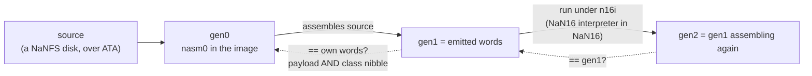

<div align="center">


<br/>


*there is a number that isn't one.*  
*there is an operation that isn't allowed.*  
*you have been asked to put them together.*

```
 ███╗   ██╗ █████╗ ███╗   ██╗      ╱    ██████╗  ███████╗
 ████╗  ██║██╔══██╗████╗  ██║     ╱    ██╔═████╗ ██╔════╝
 ██╔██╗ ██║███████║██╔██╗ ██║    ╱     ██║██╔██║ ███████╗
 ██║╚██╗██║██╔══██║██║╚██╗██║   ╱      ████╔╝██║ ╚════██║
 ██║ ╚████║██║  ██║██║ ╚████║  ╱       ╚██████╔╝ ███████║
 ╚═╝  ╚═══╝╚═╝  ╚═╝╚═╝  ╚═══╝ ╱         ╚═════╝  ╚══════╝
```


</div>

<br/>

<div align="center">

[**orientation**](#-orientation) · [**sighting**](#-sighting) · [**anatomy of a word**](#-anatomy-of-a-word) · [**the museum**](#-the-museum) · [**ladder of trust**](#-ladder-of-trust) · [**door**](#-door) · [**floor plan**](#-floor-plan) · [**vigil**](#-vigil) · [**glossary**](#-glossary)

</div>

<br/>

## `> orientation`

NaN/0S is a bare-metal museum of computing whose fundamental unit of computation is a quiet contradiction.

Every machine word is 64 bits wide and **both of its ends are IEEE 754 NaN headers**. Not one end, both: a *near* head and a *far* head, read in opposite byte orders, with a 32-bit payload sandwiched between them. Each head is one of four legal values (positive/negative × signaling/quiet), so each end carries two bits, and together the two ends spell a four-bit **class nibble**. That nibble is not metadata. It is a truth table. It is the opcode of a Boolean function. It is also the predicate that decides whether an instruction runs at all. The same four bits, read two ways, are the machine's whole sense of logic.

The guest language is **NaN16**, and every exhibit, every library, the window manager, the assembler, the interpreter that interprets NaN16 *in* NaN16, and the filesystem are written in it. The thing underneath is as small as we could make it: one thin native kernel per architecture, no host operating system, nothing between the word and the metal.

The result is a system that can **show its own work**. It reassembles itself and checks the answer word for word. It runs its own interpreter inside itself. It boots a windowed desktop, a rule‑90 fractal, a double‑endian clock, a reconstruction of the arithmetic failure that let a Scud through at Dhahran, and a curator console that lets you stare at raw memory — all in 1,474,560 bytes, one floppy.

This is not a general-purpose OS.  
It is a place. A temple that boots. A machine that refuses to look away from the places where the foundations are strange.

Primary author remains the sole architect of the core.  
A small, high-signal circle is welcome. Everything else is noise.

---

## `> sighting`

<div align="center">

<a href="https://shemshallah.github.io/NaN0S/?live=1">

</a>

**Click the image. The real guest floppy boots in your browser.**

<sub>
executed in <a href="https://github.com/copy/v86">v86</a> (x86 → WebAssembly) · no install · no host OS underneath<br/>
click the screen → <b>1–9</b> exhibits · <b>ESC</b> back · <b>~</b> curator console
</sub>

<sub>
[full screen ↗](https://shemshallah.github.io/NaN0S/?live=1)  
source: <code>docs/</code> · image: <code>docs/nan0s.img</code> (= <code>build/nan0s.img</code>)  
fork it: Settings → Pages → branch <code>main</code> / folder <code>/docs</code>
</sub>

</div>

<div align="center"></div>

## `> vital signs`

| | |
|---|---|
| **word** | 64 bits · two NaN heads (far = big-endian, near = little-endian) around a 32-bit payload |
| **instruction** | one word; the class nibble is its predicate (or, for `BOOL`, its truth table) |
| **registers** | `r0`–`r15`, 32-bit · `r0 = 0` · `r13 = 1` · `r14 = SP` · `r15 = link` · flags `Z`,`L` |
| **ISA** | opcodes `0x00`–`0x45` plus `HALT` · undefined opcodes **trap**, they do not guess |
| **traps** | `!G<pc>` the both-face gate failed · `!O<pc>` bad opcode — printed on COM1 and the machine halts |
| **image** | 1,474,560 bytes (a 1.44 MB floppy) · nine sealed exhibit cartridges in a table of contents |
| **guest source** | ≈ 33,000 lines of NaN16 across 93 `.nas` files |
| **native base** | one small kernel per architecture: `x86/native/kan16.xa` · an A64 core and an Android app · a RISC-V smoke test |
| **self-hosting** | assembler `nasm0` and interpreter `n16i` are both NaN16 · fixed point proven (see below) |
| **outer tools** | POSIX `sh` · `awk` · `xxd` · `qemu-system-i386` — the Python scaffolds are being retired ([census](spec/PYTHON_CENSUS.md)) |

<div align="center"></div>

## `> anatomy of a word`

Eight bytes, three roles.

```
 byte     b0  b1   │  b2  b3  b4  b5   │  b6  b7
          ─────────   ─────────────────   ─────────
 role     FAR head      32-bit payload     NEAR head
 read as  big-endian    little-endian      little-endian
 e.g.     FF  F8    │  2A  00  00  00    │  F8  7F
```

A head is only legal if it is one of four values. Anything else is a **gate trap** — a word with a wrong face never executes.

| head | meaning | class `c = 2·Q + S` |
|:-:|---|:-:|
| `7FF1` | positive signaling | 0 |
| `FFF1` | negative signaling | 1 |
| `7FF8` | positive quiet | 2 |
| `FFF8` | negative quiet | 3 |

The **class nibble** is `n = (c_near << 2) | c_far`. Sixteen values, sixteen Boolean functions: **bit `k` of `n` is `f(a, b)` for `k = 2a + b`**. The word above has a near head of `7FF8` (class 2) and a far head of `FFF8` (class 3), so `n = 0b1011`, and its truth table reads:

```
 a b │ f
 0 0 │ 1
 0 1 │ 1        f(a,b) = ¬a ∨ b      "a implies b"
 1 0 │ 0        — and that is not a coincidence, it is the word.
 1 1 │ 1
```

So the opcode of `BOOL` is *literally the output*. Feed it the lane constants `a = 0xCCCCCCCC`, `b = 0xAAAAAAAA` and all 32 lanes evaluate the function at once, giving `n × 0x11111111`. For this word: `0xBBBBBBBB`. Try it in exhibit **2**; the Boole laboratory builds all sixteen at runtime and checks every lane.

### The mirror law

`BSWAPM` reverses the eight bytes of a word. Reversal swaps the two faces, which rotates the nibble by two bits:

```
 rot2(n) = ((n & 3) << 2) | (n >> 2)         BOOL.rot2(n)(a, b)  ==  BOOL.n(¬a, b)
```

The implication word above, byte-swapped, becomes `n = 0b1110` — `a ∨ b`. Look: `¬(¬a) ∨ b`. Same word, other face, a different truth. Sixteen functions fall into orbits under this swap; four of them (`n = 0, 5, 10, 15`) are *neutral* — both faces agree — and they are the words that survive being read backwards. Double endianness is not a convention here. It is a second, independent channel, and the exhibits' **seals** check both.

### Predication: the same nibble, a second life

Every op except `BOOL` runs only if bit `k = 2Z + L` of its class nibble is set. The flags are the program counter's conscience; the nibble is its permission slip.

| `n` | mnemonic | runs when |
|:-:|:-:|---|
| `15` | `ALWAYS` | always |
| `0` | `NEVER` | never |
| `4` | `EQ` | `a == b` |
| `3` | `NE` | `a != b` |
| `2` | `LT` | `a < b` (unsigned) |
| `1` | `GT` | `a > b` |
| `5` | `GE` | `a ≥ b` |
| `6` | `LE` | `a ≤ b` |

(`(Z, L) = (1, 1)` is unreachable. The machine checks.)

### A line of source, decoded

```
FFF8_01D00001_F8FF   ; MOVI r13,1
```

`NNNN_PPPPPPPP_FFFF` is *near head*, *payload*, *far head as stored* (byte-swapped, hence `F8FF` for `FFF8`). Both heads quiet-negative → `n = 15` → **always**. Payload `01D00001`: op `01` = `MOVI`, `d = D = 13`, `a = 0`, `imm16 = 0001`. One word. One instruction. Two NaN faces. Every instruction in the museum is this.

<details>
<summary><b>The op map, for the cartographers</b></summary>

<br/>

Payload layout: `[31:24] op · [23:20] d · [19:16] a · [15:0] imm16` (and `b = imm[3:0]`).

| range | ops |
|---|---|
| `00`–`07` | `BOOL` · `MOVI` · `MOVHI` · `ADD` · `SUB` · `SHL` · `SHR` · `CMP` |
| `08`–`0F` | `LD` · `ST` · `JMP` · `CALL` · `RET` · `JMPR` · `NOP` |
| `10`–`1B` | `VPOKE` · `VPEEK` · `KEY` · `TICK` · `BSWAPM` · `PUTC` · `STW` · `LDN` · `DISPQ` · `DISPSET` · `KEYQ` · `BEEP` |
| `20`–`2F` | multiply and divide families, arithmetic shift, signed compare, sign-extending `ADDI`, byte loads and stores, indirect call, block copy and fill |
| `30`–`37` | the float group, with its NaN-propagation and rounding rules pinned down exactly (`core/OPS.md`) |
| `38`–`45` | far jump and call, display and framebuffer verbs, `VSYNC`, port I/O, `CPUID`, `RDTSC` |
| `FF` | `HALT` |

The frozen baseline lives in [`spec/NAN16_SPEC.md`](spec/NAN16_SPEC.md); everything added since is additive, never a semantic change. Memory is word-addressed and wraps (the v0.1 spec used 8,192 words; the current cores use 4 M).

</details>

<div align="center"></div>

## `> a boot, narrated`

You power the machine. Before a pixel appears, COM1 says one line:

```
NaN/0S R26J READY MENU=S
```

Then the museum draws itself in text mode — eighty columns, twenty-five rows, no operating system anywhere in the stack — and waits. You press a key. The shell checks the exhibit's **seal** (both faces, both payload hashes, a class channel), copies the cartridge into the run slot, and jumps. If anything is wrong with a word, the machine does not argue: it prints `!G` or `!O`, a program counter, and stops.

## `> the museum`

Nine exhibits are installed. Each shows the date of the event, who was involved and whether they are alive, why the milestone mattered, and what the code does and how. Each carries an **authenticity badge**: `EXACT` (same artifact), `RE-CREATION` (same behaviour, rewritten), or `INSPIRED` (in the spirit of the original). Every ROM is homebrew. No copyrighted code ships here.

| key | exhibit | badge |
|:-:|---|:-:|
| **1** | 1948 · **Manchester Baby** (SSEM), 21 June 1948 | RE-CREATION |
| **2** | 1854 · **Boole**, *The Laws of Thought* — all 16 functions, live | INSPIRED |
| **3** | 1915 · **Sierpinski** — Rule 90, a live fractal | RE-CREATION |
| **4** | 2026 · **About NaN/0S** — the machine, the trust, the plan | INSPIRED |
| **5** | 2026 · **About Shemshallah** — the developer | INSPIRED |
| **6** | 1984 · **Trust** — *Reflections on Trusting Trust* | INSPIRED |
| **7** | 1991 · **Patriot Missile Failure**, Dhahran | RE-CREATION |
| **8** | 2026 · **Paradox Engine** — an sNaN/qNaN contradiction oscillator | INSPIRED |
| **9** | 2026 · **Settings** — NANNET, Driver and Codec managers | RE-CREATION |
| **~** | the **Curator Console** — raw guest memory, four payloads per row, read-only | — |

A few things worth knowing before you go in:

- **#7** is a small lesson in what a clock tick cannot be: a tenth of a second has no finite binary expansion, so a 24-bit fixed-point conversion truncated a hair on every tick — and after about 100 hours of continuous operation the hair had become a missed interception. The plaque walks through the arithmetic and is honest about which figures are approximate.
- **#8** flips a word between signaling and quiet and reads it from both ends. Watch `LE TIME` and `BE TIME` argue.
- **#6** is the full paper *Trusting Trust in a Double-Endian NaN Machine* ([`spec/TRUST_PAPER.md`](spec/TRUST_PAPER.md)), scrollable, 376 wrapped lines.
- **#9** opens Settings: NANNET Manager (link controls and status), Driver Manager (13-driver registry and load toggles), and Codec Manager (storage codec catalog). The desktop is the system boot cart, not a slot.
- **Next hall:** Hall 1, the Apollo AGC / DSKY port, is the flagship ([`spec/APOLLO_AGC_PLAN.md`](spec/APOLLO_AGC_PLAN.md)).

<div align="center"></div>

## `> ladder of trust`

Thompson's question — *can you trust a program if you cannot trust the thing that built it?* — is answered here the only way it can be: by making the builder small enough to read, then checking it against itself.



- **`nasm0`** — the word assembler, written in NaN16.
- **`n16i`** — a complete NaN16 interpreter, written in NaN16: every op, the both-face gate, bad-op trap, predication. It runs guests inside the guest, nested to any depth.
- **`NaNFS`** — a tiny filesystem on an ATA disk, so the assembler can be fed its own source from a block device rather than from a host trick.
- **The fixpoint gate** (`tools/ngate_nfix.sh`): gen0 copies its own words aside, loads its own flattened source from the disk, assembles it, and must reproduce **itself** exactly — 1,753 words, class nibble included (`F1 PASS`). Then gen1, running under the raw-NaN interpreter, assembles the same source and must reproduce **gen1** (`F2 PASS`). Corrupt a single byte of the source on disk and the gate fails at the first word that differs (`F1 FAIL first=00000106`). A gate that cannot fail proves nothing; this one is tested to fail.
- **The differential gate** (`tools/ngate_n16i.sh`): the full test suite run natively (73,982 steps) and again under `n16i` (3,343,783 steps) must emit identical bytes and the identical `!G` and `!O` traps, at nesting depths 0, 1 and 2.
- **Cross-architecture oracle:** the portable C core in `aarch64/android` has 866 unit checks, passes under ASan/UBSan, and is differentially tested against the *real* x86 kernel under QEMU — the museum menu is byte-identical, the VBE desktop is pixel-identical.

| gate | what it asserts |
|---|---|
| `sh x86/tools/mkall.sh` | the floppy image is assembled from the `.nas` sources by `sh` + `awk` |
| `sh x86/tools/qgate.sh` | the bare-metal boot prints the COM1 banner |
| `sh tools/ngate_nfix.sh` | `nasm0` is a fixed point: gen0 = gen1 = gen2 |
| `sh tools/ngate_n16i.sh` | native and interpreted runs are indistinguishable |
| `sh tools/tm_gate.sh` | table-driven NaN16 Turing machine: native == n16i, exact tapes |
| `make seals` · `make test` (in `aarch64/android`) | exhibits can be run in any order without corrupting one another's seals · the C core's 866 checks |

The long form, with the diverse-double-compilation argument and the dual-face seal, is the [**Trust paper**](spec/TRUST_PAPER.md).

<div align="center"></div>

## `> what it actually is`

NaN/0S is a single-address-space, ring-0-feeling, NaN16 guest running on a minimal native kernel. The guest word stream is intended to be architecture-neutral; only the thinnest boot shim and a few native primitives differ between x86, AArch64, and the RISC-V smoke tests.

Key technical facts:

- **Word model**: 64-bit values whose two ends are both NaN headers. Both faces are meaningful. The mirror law and the both-face gate are load-bearing.
- **NaN16**: a compact instruction set where the interesting ops (the ones IEEE and two's-complement treat as errors or traps) are the ones you actually use.
- **Self-hosting path**: `nasm0` (written in NaN16) reassembles itself and the rest of the museum. Fixed-point proofs exist and are re-run by gate, not by faith.
- **Exhibits as cartridges**: sealed, loadable, verifiable. The desktop, the Trust paper, the Boolean laboratory, the Sierpinski process, the Patriot reconstruction, and the curator are all guest code.
- **Purity constraint**: the outer build and gate stack is driven toward `sh` + `awk` + `xxd` + `qemu` and nothing else. What remains of the Python scaffolding is on the retirement list, with the replacements already written in NaN16.

It sits in a thin and deliberate tradition:

- TempleOS (one human, non-negotiable constraints, the machine as temple)
- the early Plan 9 attitude (simplicity as moral position)
- Collapse OS / UXN / Varvara (computational survivalism and radical smallness)
- the older Forth and Lisp worlds that treated the machine as a place you live in

Most systems try to hide the strange places in the foundations.  
This one is built to keep them in view and make them runnable.

---

## `> manifest`

```diff
+ 1
+ 2
+ 3
- 4
- ·
- ·
! 4095
```

```
ff 00 00 00 00 08 f8 7f
```

Read it backwards. Then read it as nothing.

<div align="center"></div>

## `> intercepted`

> *"bits 8–34 are reserved and must be zero."*  
> *"undefined opcodes must trap."*  
> *"do not use floating-point arithmetic."*

Three sentences. One entire worldview. We will not elaborate.

<div align="center"></div>

## `> signal`

Thirteen words fell out of the build. Each one is a quiet NaN. None of them is an error.

```
7ff8002000000043
7ff8005800000030
7ff8006800000035
7ff800400000004e
7ff8005000000034
7ff800280000004b
7ff8006000000039
7ff8004800000020
7ff800100000004e
7ff800080000004b
7ff800380000004f
7ff800180000004f
7ff8003000000020
```

- no checksum  
- no key  
- the order is in the machine  
- the message is in the rest  

First to decode it, open an issue titled with what it says.  
We will neither confirm nor deny. We will *notice*.

<div align="center"></div>

## `> pieces on the table`

| | |
|:-:|---|
| 🟣 | `██████████` |
| 🟢 | `x != x` |
| 🔵 | `███ ██ ████` |
| 🟡 | a thing that reads itself |
| 🟠 | a thing that refuses to |
| 🔴 | `[ ]` ← *eventually* |
| ⚫ | the quiet part |

<div align="center"></div>

## `> three bodies`

The guest is the point. The native cores are only the thinnest necessary substrate, and there is more than one.

**x86 — the first body.** A boot sector, a small native kernel (`x86/native/kan16.xa`), and the floppy image. It boots on QEMU and, through v86, in your browser. This is the reference: every other core is judged against it.

**aarch64 — the second body.** An A64 core, and a portable C core (`aarch64/android/core/`) that runs the same guest. Wrapped in JNI and a small Kotlin app it becomes an Android APK, built by GitHub Actions on every push. Because it is plain C it is also the project's test bench: unit tests, sanitizers, and differential fuzzing against the real x86 kernel under QEMU.

**riscv — the third body.** A smoke test and a promise. The guest does not change; only the substrate does. That is the whole design.

## `> floor plan`

```
x86/        the first body — boot sector, native kernel, the floppy image
aarch64/    the second body — A64 core + the portable C core + Android app
riscv/      the third body — smoke test and a promise
src/        what runs on all of them: NaN16, written in NaN16
  lib/        drivers and libraries — framebuffer, fonts, keyboard, ATA, NaNFS, window manager
  exhibits/   the nine cartridges
  museum/     the shell: menu, plaques, loader, seals
  prog/       nasm0, nasm1 (byte assembler), nbuild (the self-hosted builder), nalloc
  tools/      n16i — NaN16 interpreting NaN16
  tests/      guests that test the machine, from inside it
  net/        network primitives (crc32, base64, hex, ...) for the networking museum, built from scratch
  puzzle/ · translate/ · vm/ · nan/ · draft/
spec/       the reasoning, the Trust paper, the plans
tools/      host-side outer tools: mkimg.awk · nmk.awk · the gates
docs/       status, the live player, the map
logs/       recorded evidence from past rounds
```

<div align="center"></div>

## `> door`

```sh
git clone https://github.com/shemshallah/nan0s
cd nan0s
sh x86/tools/mkall.sh
qemu-system-i386 -m 32 -drive format=raw,if=floppy,file=x86/build/nan0s.img
```

The image that comes out is the same bytes that the live web player boots.

You need `sh`, `awk`, `xxd` and `qemu-system-i386`. That is the whole list.

**Press `1`–`9`.** `ESC` redraws the menu. `~` (shift + backtick) opens the curator console.

**Run the gates.**

```sh
sh x86/tools/qgate.sh      # boot gate
sh tools/ngate_nfix.sh     # nasm0 fixed point  → F1 PASS · F2 PASS · FIX PASS
sh tools/ngate_n16i.sh     # native == interpreted
sh tools/tm_gate.sh        # table-driven TM native == n16i
```

**Without QEMU.** The portable core runs the same image from a terminal:

```sh
make -C aarch64/android            # builds ./nan_cli
./aarch64/android/nan_cli --img x86/build/nan0s.img --steps 40000000 --keys 1 --dump-text
make -C aarch64/android test       # 866 checks
```

Android path: [`aarch64/android/docs/HANDOFF.md`](aarch64/android/docs/HANDOFF.md)  
Current status and gate census: [`docs/STATUS.md`](docs/STATUS.md)  
Living TODO: [`TODO.md`](TODO.md)

<details>
<summary><b>A reading order, for the terminally curious</b></summary>

<br/>

1. [`spec/NAN16_SPEC.md`](spec/NAN16_SPEC.md) — one page. The word, the machine, the ops.
2. [`src/exhibits/boole_cart.nas`](src/exhibits/boole_cart.nas) — the truth-table trick, running.
3. [`spec/TRUST_PAPER.md`](spec/TRUST_PAPER.md) — why the double endianness is a security property.
4. [`spec/SELF_HOSTING.md`](spec/SELF_HOSTING.md) and [`spec/BOOTSTRAP_PLAN.md`](spec/BOOTSTRAP_PLAN.md) — how a toolchain climbs out of nothing.
5. [`src/tools/n16i.nas`](src/tools/n16i.nas) — NaN16 interpreting NaN16, 526 lines.
6. [`src/prog/nasm0.nas`](src/prog/nasm0.nas) — the assembler that assembles itself.
7. [`spec/TOOL01_PLAN.md`](spec/TOOL01_PLAN.md) — the retirement of the scaffolds, with the lesson about duplicate labels.
8. [`spec/MUSEUM_PLAN.md`](spec/MUSEUM_PLAN.md) and [`spec/FAILURE_EXHIBITS_PLAN.md`](spec/FAILURE_EXHIBITS_PLAN.md) — where the halls are going.

</details>

<div align="center"></div>

## `> vigil`

What is solid, and what is in flight. Nothing here is rounded up.

- **Solid:** the word model, the both-face gate, the nine exhibits, the sealed cartridge store, the `nasm0` fixed point, `n16i` and its differential gate, the table-driven TM native/n16i gate, NaNFS, the portable C core, the browser player.
- **In flight:** retiring the last Python scaffolds from `tools/` (replacements are NaN16, assembled by `nasm0`, run by the gates above); the Android app's first on-device fixes (portrait scaling, pinch-zoom, a GUI that fits any screen); a launcher so the desktop can open any cartridge; one canonical Sierpinski instead of two.
- **Ahead:** Hall 1 — the Apollo guidance computer; the failure exhibits; the networking museum (modern and historical, from scratch, universal across all three bodies); a 16 GB bank window; RISC-V made real.

A sentence this project holds itself to: *a check that cannot fail is not a check.* Every gate here has been broken on purpose at least once to prove it can say no.

## `> glossary`

| term | meaning |
|---|---|
| **face** | one end of a word: its head, read in its own byte order. Every word has two. |
| **head** | the 16-bit NaN header at an end: `7FF1`, `FFF1`, `7FF8` or `FFF8`. |
| **class nibble** | `n`, four bits drawn from the two heads. Truth table for `BOOL`; predicate mask for everything else. |
| **gate** | the load-time check that both heads are legal. A failure prints `!G` and halts. |
| **mirror law** | `BOOL.rot2(n)(a,b) = BOOL.n(¬a,b)`: byte-swapping a word swaps its faces. |
| **neutral word** | a word whose two faces agree (`n` ∈ {0, 5, 10, 15}); it reads the same backwards. |
| **seal** | the check on a cartridge: both faces, both payload hashes, and a class channel. |
| **cartridge** | an exhibit packaged as sealed words with a table-of-contents entry. |
| **NaN16** | the guest ISA and the language everything is written in. |
| **`.nas` / `.nan`** | NaN16 assembly source / assembled words as text, `NNNN_PPPPPPPP_FFFF`. |
| **`nasm0`** | the NaN16 word assembler, written in NaN16. |
| **`n16i`** | the NaN16 interpreter, written in NaN16. |
| **fixpoint** | gen0 = gen1 = gen2: the toolchain reproduces itself, word for word. |
| **Curator Console** | `~`: a read-only view of raw guest memory, four payloads per row. |

<div align="center"></div>

## `> circle`

This remains a primary-author project.

A small circle of people who understand the constraints, the tone, and the cost of purity is welcome. The preferred contributions are:

- new sealed exhibits that belong in the museum
- clean architecture adapters that do not enlarge the trusted base
- improvements to the pure `sh`/`awk` outer tools

Everything that tries to turn NaN/0S into a normal operating system, a friendly community product, or a vehicle for unrelated ideas will be declined without lengthy discussion.

If you decode the signal, open the issue.  
If you build something that belongs here, make it small, exact, and sealable.

Licensed under [Apache-2.0](LICENSE).

---

## `> final note`

Most machines are designed to make the strange parts of computation invisible.  
This one is designed to make them the main exhibit.

⭐ if you understood any of this.  
⭐⭐ if you didn’t, and it bothered you.

## `> crypt`

The public encryption suite lives in [`crypt/`](crypt/README.md): NSP-7/NSP-8
capsule AEAD reference, the NSPF1 authenticated file container, and
`crypt/nspfile`, plus NSPV storage volumes for x86 HDD and Android fd.
Suites 3/4/5 (X25519+Ed25519, ML-KEM-768+ML-DSA-44,
SLH-DSA) are planned and refused until implemented. Encrypted system boot
is pending.

<br/>

<div align="center">

`7ff8 ····`

**`NaN ≠ NaN`**

<sub>divide by nothing. get everything.</sub>

</div>
