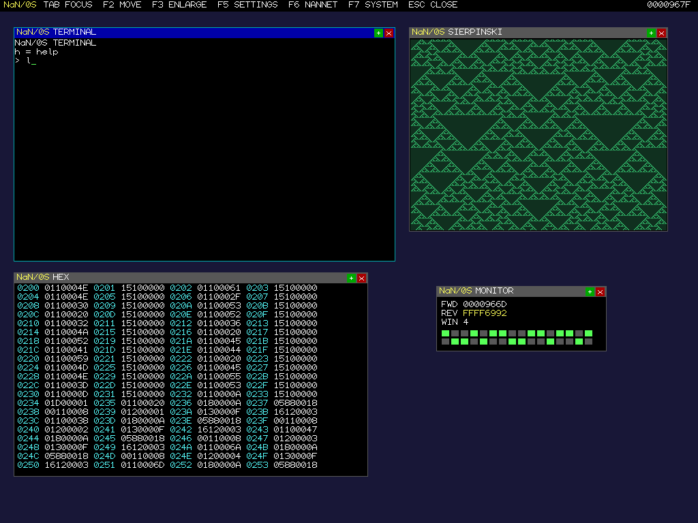

<div align="center">



<br/>


*there is a number that isn't one.*  
*there is an operation that isn't allowed.*  
*you have been asked to put them together.*

```
 ███╗   ██╗ █████╗ ███╗   ██╗      ╱    ██████╗  ███████╗
 ████╗  ██║██╔══██╗████╗  ██║     ╱    ██╔═████╗ ██╔════╝
 ██╔██╗ ██║███████║██╔██╗ ██║    ╱     ██║██╔██║ ███████╗
 ██║╚██╗██║██╔══██║██║╚██╗██║   ╱      ████╔╝██║ ╚════██║
 ██║ ╚████║██║  ██║██║ ╚████║  ╱       ╚██████╔╝ ███████║
 ╚═╝  ╚═══╝╚═╝  ╚═╝╚═╝  ╚═══╝ ╱         ╚═════╝  ╚══════╝
```


</div>

<br/>

## `> orientation`

NaN0S is a bare-metal museum of computing whose fundamental unit of computation is a quiet contradiction.

Every machine word is a 64-bit double-ended NaN-like value. The high bits look like a quiet IEEE 754 NaN; the low bits are the payload. The system is built so that the most interesting operations are the ones that ordinary machines are required to treat as errors or undefined. The guest language (NaN16) makes those operations first-class.

The result is a system that can show its own work. It can reassemble itself. It can exhibit the exact arithmetic failures that have killed people and lost rockets. It can run a windowed desktop, a rule-90 Sierpinski process, a double-endian timer, and a curator that lets you stare at the raw words — all without a host operating system underneath.

Outer tools are deliberately starved: POSIX `sh` + `awk` + `xxd` + `qemu-system-i386`. No Python in the live path. The image rebuilds byte-for-byte from the `.nas` sources.

This is not a general-purpose OS.  
It is a place. A temple that boots. A machine that refuses to look away from the places where the foundations are strange.

Primary author remains the sole architect of the core.  
A small, high-signal circle is welcome. Everything else is noise.

---

## `> sighting`

<div align="center">

<a href="https://shemshallah.github.io/NaN0S/?live=1">

</a>

**Click the image. The real guest floppy boots in your browser.**

<sub>
executed in <a href="https://github.com/copy/v86">v86</a> (x86 → WebAssembly) · no install · no host OS underneath<br/>
click the screen → <b>1–9</b> exhibits · <b>ESC</b> back · <b>~</b> curator console
</sub>

<sub>
[full screen ↗](https://shemshallah.github.io/NaN0S/?live=1)  
source: <code>docs/</code> · image: <code>docs/nan0s.img</code> (= <code>build/nan0s.img</code>)  
fork it: Settings → Pages → branch <code>main</code> / folder <code>/docs</code>
</sub>

</div>

<div align="center"></div>

## `> what it actually is`

NaN0S is a single-address-space, ring-0-feeling, NaN16 guest running on a minimal native kernel. The guest word stream is intended to be architecture-neutral; only the thinnest boot shim and a few native primitives differ between x86, AArch64, and the RISC-V smoke tests.

Key technical facts:

- **Word model**: 64-bit values that are both payload and quiet NaN. Both faces are meaningful. The mirror law and the both-face gate are load-bearing.
- **NaN16**: a compact instruction set where the interesting ops (the ones IEEE and two’s-complement treat as errors or traps) are the ones you actually use.
- **Self-hosting path**: `nasm0` (written in NaN16) can reassemble itself and the rest of the museum. Fixed-point proofs exist.
- **Exhibits as cartridges**: sealed, loadable, verifiable. The desktop, the Trust paper, the Boolean laboratory, the Sierpinski process, the Patriot reconstruction, and the curator are all guest code.
- **Purity constraint**: the outer build and gate stack has been driven to `sh` + `awk` + `xxd` + `qemu`. The Python scaffolds were retired on purpose.

It sits in a thin and deliberate tradition:

- TempleOS (one human, non-negotiable constraints, the machine as temple)
- the early Plan 9 attitude (simplicity as moral position)
- Collapse OS / UXN / Varvara (computational survivalism and radical smallness)
- the older Forth and Lisp worlds that treated the machine as a place you live in

Most systems try to hide the strange places in the foundations.  
This one is built to keep them in view and make them runnable.

---

## `> manifest`

```diff
+ 1
+ 2
+ 3
- 4
- ·
- ·
! 4095
```

```
ff 00 00 00 00 08 f8 7f
```

Read it backwards. Then read it as nothing.

<div align="center"></div>

## `> intercepted`

> *"bits 8–34 are reserved and must be zero."*  
> *"undefined opcodes must trap."*  
> *"do not use floating-point arithmetic."*

Three sentences. One entire worldview. We will not elaborate.

<div align="center"></div>

## `> signal`

Thirteen words fell out of the build. Each one is a quiet NaN. None of them is an error.

```
7ff8002000000043
7ff8005800000030
7ff8006800000035
7ff800400000004e
7ff8005000000034
7ff800280000004b
7ff8006000000039
7ff8004800000020
7ff800100000004e
7ff800080000004b
7ff800380000004f
7ff800180000004f
7ff8003000000020
```

- no checksum  
- no key  
- the order is in the machine  
- the message is in the rest  

First to decode it, open an issue titled with what it says.  
We will neither confirm nor deny. We will *notice*.

<div align="center"></div>

## `> pieces on the table`

| | |
|:-:|---|
| 🟣 | `██████████` |
| 🟢 | `x != x` |
| 🔵 | `███ ██ ████` |
| 🟡 | a thing that reads itself |
| 🟠 | a thing that refuses to |
| 🔴 | `[ ]` ← *eventually* |
| ⚫ | the quiet part |

<div align="center"></div>

## `> floor plan`

```
x86/       the first body — boot sector, native kernel, the floppy image
aarch64/   the second body — A64 core + Android app
riscv/     the third body — smoke test and a promise
src/       what runs on all of them: NaN16, written in NaN16
spec/      the reasoning, the Trust paper, the plans
docs/      status, the live player, the map
```

The guest is the point. The native cores are only the thinnest necessary substrate.

<div align="center"></div>

## `> door`

```sh
git clone https://github.com/shemshallah/nan0s
cd nan0s
sh x86/tools/mkall.sh
qemu-system-i386 -m 32 -drive format=raw,if=floppy,file=x86/build/nan0s.img
```

The image that comes out is the same bytes that the live web player boots.

Android path: `aarch64/android/docs/HANDOFF.md`  
Current status and gate census: [`docs/STATUS.md`](docs/STATUS.md)  
Living TODO: [`TODO.md`](TODO.md)

---

## `> circle`

This remains a primary-author project.

A small circle of people who understand the constraints, the tone, and the cost of purity is welcome. The preferred contributions are:

- new sealed exhibits that belong in the museum
- clean architecture adapters that do not enlarge the trusted base
- improvements to the pure `sh`/`awk` outer tools

Everything that tries to turn NaN0S into a normal operating system, a friendly community product, or a vehicle for unrelated ideas will be declined without lengthy discussion.

If you decode the signal, open the issue.  
If you build something that belongs here, make it small, exact, and sealable.

---

## `> final note`

Most machines are designed to make the strange parts of computation invisible.  
This one is designed to make them the main exhibit.

⭐ if you understood any of this.  
⭐⭐ if you didn’t, and it bothered you.

<br/>

<div align="center">

`7ff8 ····`

**`NaN ≠ NaN`**

<sub>divide by nothing. get everything.</sub>

</div>
